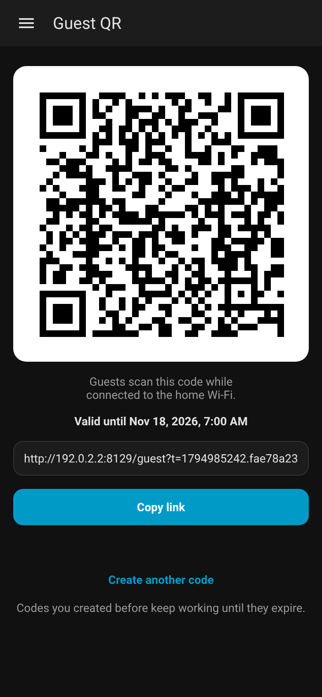

# HA Guest

🇬🇧 [Read in English](README.md)

Integración para Home Assistant que deja a tus invitados manejar **solo las entidades que tú elijas** y **solo
mientras están conectados a tu red**.

Cubre dos tipos de invitado:

| | Quién | Cómo entra | Qué puede hacer |
|---|---|---|---|
| **Panel de invitados** | Un amigo que va a tu casa | Abre `http://<tu-home-assistant>:8123/guest` en el navegador. Sin app y sin usuario | Maneja las entidades del panel, solo desde tu red |
| **Usuario restringido** | Alguien con la app de Home Assistant (p. ej. tu suegra, para compartir ubicación) | Con su usuario, en la app o el navegador | Siempre: lo que le permitas (p. ej. Family Location). Luces y demás: solo cuando su teléfono está en tu WiFi |

 

## Instalación

1. HACS → menú ⋮ → *Repositorios personalizados* → agrega este repositorio como **Integración**.
2. Instala **HA Guest** y reinicia Home Assistant.
3. *Ajustes → Dispositivos y servicios → Añadir integración → HA Guest.*

Requiere Home Assistant 2025.3 o superior.

## Panel de invitados (sin cuenta)

Al añadir la integración se configura el panel:

- **Redes permitidas:** la red de tu WiFi en formato CIDR, por ejemplo `192.168.1.0/24`. Se propone la red de tu
  Home Assistant. Si tienes una red de invitados aparte, pon esa (y asegúrate de que el router le permita llegar
  a Home Assistant).
- **Entidades:** las que el invitado puede manejar. Luces (con brillo), enchufes, ventiladores, cortinas,
  cerraduras, escenas, scripts, botones, clima, reproductores y aspiradoras tienen controles; cualquier otra
  entidad se muestra como solo lectura.

El invitado entra a `http://<ip-de-home-assistant>:8123/guest`. Lo más cómodo es dejar un código QR con esa
dirección. Desde otra red, la página solo muestra «Conéctate al WiFi de la casa» junto a la dirección IP que
Home Assistant ve, lo que sirve para ajustar las redes permitidas.

### Usar un dashboard

En vez de una lista de entidades, en **Qué pueden manejar** puedes elegir **Un dashboard**: arma un dashboard
normal de Home Assistant para invitados (*Ajustes → Dashboards → Añadir dashboard*) y elígelo. Así los invitados:

- ven todas las entidades que muestran las tarjetas del dashboard, bajo los títulos de sus vistas, sus tarjetas
  de encabezado y los títulos de sus tarjetas, en el mismo orden, con los nombres e iconos puestos en las tarjetas;
- solo pueden usar esas entidades. Si quitas una tarjeta del dashboard, el invitado pierde esa entidad al
  instante; si agregas una, la gana.

La página de invitados igual dibuja sus propias tarjetas: lee el dashboard, no lo muestra, así que los invitados
no necesitan cuenta. Se entiende cualquier tarjeta que indique `entity` o `entities` (tile, botón, entidades,
glance, luz, termostato, pilas, cuadrículas, tarjetas condicionales, picture elements y tarjetas personalizadas
que usen esas claves). Las tarjetas que eligen entidades de otra forma, como la tarjeta de área, no aportan nada.
El dashboard «Resumen» generado automáticamente no sirve hasta que lo edites. Con un dashboard como fuente, el
diseño YAML de *Apariencia del panel de invitados* no se usa. En Home Assistant solo los administradores pueden
editar dashboards, así que solo ellos pueden cambiar lo que manejan los invitados.


### Personalizar el aspecto

La página sigue cómo ya tienes configurado tu Home Assistant, y el resto está en **Configurar → Apariencia del
panel de invitados**:

- **Nombres e iconos** son los que tus entidades tienen en Home Assistant. Cámbialos ahí y la página de
  invitados los toma.
- **Tema:** cualquier tema instalado en tu Home Assistant (`frontend: themes:` o temas de HACS). Se aplican sus
  colores, sus variantes clara y oscura y el radio de las tarjetas.
- **Modo claro u oscuro**, un **color de acento** (`#rrggbb`) que reemplaza el color principal del tema, y si se
  **muestran iconos**.
- **Mensaje de bienvenida:** se muestra bajo el título, por ejemplo las reglas de la casa.
- **Diseño (YAML):** por defecto las entidades se agrupan por área. Para elegir el orden, las secciones y los
  nombres e iconos de cada tarjeta, escribe un diseño con el mismo estilo que una tarjeta de entidades:

  ```yaml
  - title: Living
    entities:
      - entity: light.living_room
        name: Luces del techo
        icon: mdi:ceiling-light
      - cover.curtain
  - title: Escenas
    entities:
      - entity: scene.movie_night
        icon: mdi:movie-open
  ```

  Cada entidad también puede definir el texto de su estado y de sus botones, y usar un icono distinto por estado:

  ```yaml
  - title: Recibidor
    entities:
      - entity: lock.puerta_peaton
        name: Puerta peatonal
        icon:
          locked: mdi:door-closed-lock
          unlocked: mdi:door-open
        states:
          locked: Cerrada con llave
          unlocked: Abierta
        buttons:
          unlock: Abrir puerta
          lock: Cerrar con llave
  ```

  `buttons` acepta `open`, `close`, `stop`, `lock`, `unlock`, `activate`, `play_pause`, `start` y `dock`.
  `states` usa los estados internos de la entidad tal como los informa Home Assistant (`on`, `off`, `locked`,
  `open`…). Sin un icono propio, los iconos ya cambian con el estado como en Home Assistant (candado abierto al
  desbloquear, ampolleta vacía al apagar).

  

  El diseño solo ordena las tarjetas. Los invitados siguen pudiendo usar únicamente las entidades de la lista
  del panel, y el formulario te avisa si el diseño nombra una que no está en ella.


Los valores de un tema que apuntan a otras variables (`var(--…)`) se omiten, porque no se pueden resolver fuera
de Home Assistant. La página no es un panel Lovelace: no ejecuta tarjetas personalizadas.

### Enlaces que vencen (códigos QR)

Estar en el WiFi no siempre basta: alguien a quien invitaste una vez podría volver otro día, pararse al alcance
de la red y apagarte las luces. Para evitarlo, pon en **Duración del enlace de invitados** una cantidad de horas.

- La dirección `/guest` a secas deja de funcionar. El invitado necesita un enlace con un código, y cada enlace
  sirve solo esa cantidad de horas desde que se creó.
- Los enlaces se crean en la página **Guest QR** de la barra lateral de Home Assistant, que muestra un código QR
  nuevo cada vez que se abre. El invitado lo escanea con la cámara del teléfono, conectado a tu WiFi, o le
  envías el enlace con **Compartir enlace** / **Copiar enlace**.
- **Cualquier usuario de Home Assistant de tu casa puede crear códigos**, sea o no administrador, desde la app
  o el navegador, incluso estando fuera de casa. Los usuarios restringidos (ver más abajo) no pueden.
- Cuando el enlace vence, el invitado ve «Este enlace ya no es válido» y debe escanear un código nuevo.
- **Configurar → Anular todos los enlaces de invitados** corta de inmediato todos los enlaces entregados hasta
  ahora. Acortar la duración también corta los enlaces creados con una duración mayor.

Con la duración en 0 (por defecto) los enlaces no vencen y la página Guest QR muestra la dirección a secas.
El código QR usa la dirección local de Home Assistant (*Ajustes → Sistema → Red → Red local*).

Home Assistant no puede ver el nombre del WiFi del visitante, solo su dirección IP: por eso el panel se
restringe por red. El acceso remoto por Home Assistant Cloud (Nabu Casa) siempre se rechaza. Si usas un proxy
inverso, configura `trusted_proxies` en `http:` para que Home Assistant vea la IP real del visitante.

### Seguridad y avisos

En **Configurar → Seguridad y avisos**:

- **Solo si hay alguien de la casa:** el panel deja de responder si ninguna `person` está en `home`. Las
  personas que son usuarios restringidos (un familiar que comparte su ubicación) no cuentan. Esto impide que
  alguien a quien invitaste una vez se pare afuera, al alcance del WiFi, cuando no hay nadie.
- **Solo mientras esta entidad esté en uno de estos estados:** por ejemplo tu alarma, `disarmed`.
- **Avisar a** uno o más servicios de notificación (p. ej. `mobile_app_mi_telefono`) **cuando** un invitado abre
  el panel, usa algo, o alguien es rechazado (enlace vencido o no válido, o panel pausado). Los intentos
  repetidos del mismo invitado se avisan como mucho una vez por hora.

Mientras está pausado, el invitado ve «El panel de invitados no está disponible ahora», sea cual sea el motivo,
para que la página nunca revele que no hay nadie en casa.

Todo lo que hacen los invitados queda en el **registro** de Home Assistant («Invitado (192.168.1.20) apagó Luces
del living»), también en el historial de la propia entidad, y se dispara como evento `ha_guest_event` para tus
automatizaciones:

| `type` | Datos adicionales |
|---|---|
| `open` | |
| `action` | `entity_id`, `name`, `action` (`turn_on`, `turn_off`, `open`, `brightness`…), `value` |
| `blocked` | `reason`: `link` o `paused` |

Todos los eventos llevan además `ip`, `link` (un identificador corto del enlace del invitado, cuando se exigen
enlaces) y `link_expires`.

La integración agrega dos entidades en un dispositivo «Panel de invitados»:

- **`switch.guest_panel`**: pausa el panel sin tocar su configuración. Úsalo desde un panel o una automatización
  (p. ej. apagarlo al armar la alarma); conserva su estado al reiniciar.
- **`binary_sensor.guest_panel_in_use`**: encendido mientras un invitado tiene el panel abierto o lo usó en los
  últimos 5 minutos, con la cantidad de invitados (`guests`) y `last_seen` como atributos.

Los nombres de estas entidades dependen del idioma de tu Home Assistant al instalar la integración.

### Seguridad

Lo que revisa el panel de invitados en cada solicitud, y lo que significa:

- **Red:** solo entran direcciones de las redes permitidas. Home Assistant Cloud siempre se rechaza, y las cabeceras
  `X-Forwarded-For` o `Forwarded` falsas se ignoran salvo que vengan de un proxy que pusiste en `trusted_proxies`.
  Nunca agregues a las redes permitidas la red interna de tu proxy inverso o de Docker.
- **Enlace:** con una duración mayor que 0 (12 horas por defecto), un enlace sirve solo hasta que vence. Un QR
  viejo, un enlace con la fecha cambiada o uno inventado se rechazan; la firma es de 128 bits. **Con 0 no se pide
  enlace: cualquiera conectado a las redes permitidas entra, incluso con un QR viejo.**
- **Dirección:** el panel solo responde si se abre con una dirección IP, un nombre `.local`, o la URL interna o
  externa de Home Assistant, así que una página web abierta en tu red no puede usarlo a través de su propio
  dominio (DNS rebinding). Si lo abres con otro nombre, ponlo como URL interna.
- **Acciones:** solo las entidades de la lista del panel (o del dashboard), y solo las acciones que ofrece su tarjeta.

Lo que no puede impedir: un enlace todavía vigente sirve para cualquiera a quien se lo reenvíen y esté en tu red,
hasta que venza. Usa una duración corta, anula todos los enlaces cuando haga falta y considera «Solo si hay alguien
de la casa».

Para los usuarios restringidos, el nombre del WiFi (SSID) es fácil de imitar: cualquiera puede ponerle ese nombre a
un hotspot. Es mejor el sensor BSSID del teléfono (la dirección de tu router) o, mejor aún, un `device_tracker` de tu
router.

## Usuarios restringidos (con la app)

1. Crea a la persona en *Ajustes → Personas* con un usuario **que no sea administrador** e instálale la app.
2. En la página de la integración: **Configurar → Restringir a un usuario**.
3. Define sus permisos:
   - **Entidades permitidas siempre:** las ve y maneja desde cualquier lugar.
   - **Incluir Family Location:** permite siempre el mapa (personas y zonas) y las entidades de
     [Family Location](https://github.com/Ctuna89/HA-Family-Location), incluidos los botones de check-in y de
     pedir ayuda.
   - **Entidades permitidas solo en casa:** p. ej. las luces del living.
   - **Entidad que indica que está en casa**: normalmente el sensor de conexión WiFi de su
     teléfono (`sensor.<teléfono>_wifi_connection` en Android, `sensor.<teléfono>_ssid` en iPhone) y el nombre de
     tu WiFi. También puedes usar un `device_tracker` de tu router con el estado `home`, que es más difícil de
     engañar que el nombre de la red.
   - **Fuera de casa, mostrarlas como solo lectura:** si está apagado, fuera de casa no le aparecen.
4. El paso siguiente muestra **qué informa esa entidad en ese momento** y lo propone como estado de «en casa».
   Si el teléfono está en tu WiFi en ese instante, acéptalo; un estado que no coincide exactamente nunca da
   acceso.

Todo lo que no esté en esas listas deja de verlo y de poder manejarlo. Home Assistant aplica la restricción en
el servidor, así que vale igual para la app, el navegador y la API.

### A tener en cuenta

- Al llegar a casa, las entidades «solo en casa» pueden tardar en aparecer en una app que ya estaba abierta:
  aparecen cuando cambian de estado o al volver a abrir la app.
- Su panel por defecto es el mismo que el tuyo, con huecos donde no tiene permiso. Conviene crearle un panel
  propio con lo que sí puede usar y dejarlo como su panel predeterminado.
- La restricción cubre ver el estado y manejar entidades. Home Assistant no filtra por usuario todo lo demás:
  un usuario restringido todavía puede ejecutar acciones que no apuntan a una entidad (como las de check-in y
  ayuda de Family Location, que es lo que se busca) y partes como el historial no siempre respetan los permisos.
- Los grupos de permisos a medida no tienen API pública en Home Assistant; la integración usa su almacenamiento
  interno de usuarios, así que una versión futura de Home Assistant podría requerir actualizarla.
- Si desactivas la integración, los usuarios restringidos quedan con su acceso de «fuera de casa». Al quitar la
  restricción a un usuario, o al eliminar la integración, recuperan el acceso normal.

## Desarrollo

```bash
pip install pytest-homeassistant-custom-component segno==1.6.6
```

```bash
python -c "import json, pathlib, homeassistant.components.frontend as f; print(*json.loads((pathlib.Path(f.__file__).parent / 'manifest.json').read_text())['requirements'])" | xargs pip install
```

```bash
pytest tests
```

### Publicar una versión

Las versiones las publica `.github/workflows/release.yml` cuando cambia `main`: sube `version` en
`custom_components/ha_guest/manifest.json`, agrega su sección en `CHANGELOG.md` y fusiona en `main`. El workflow
crea la versión `v<versión>` con esa sección como notas, y no hace nada si esa versión ya estaba publicada.
