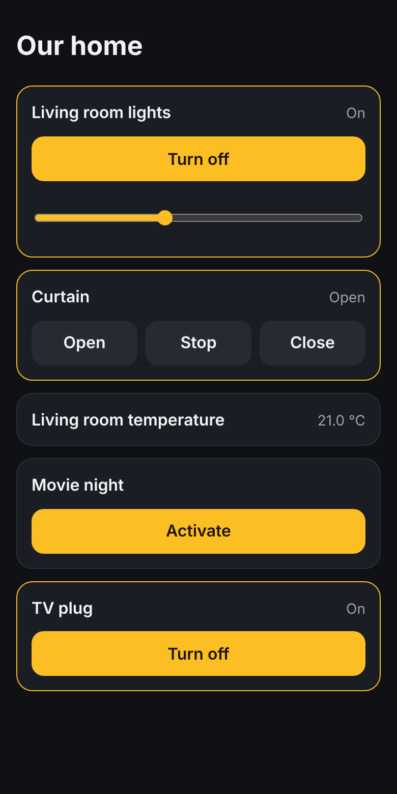

# HA Guest

🇬🇧 [Read in English](README.md)

Integración para Home Assistant que deja a tus invitados manejar **solo las entidades que tú elijas** y **solo
mientras están conectados a tu red**.

Cubre dos tipos de invitado:

| | Quién | Cómo entra | Qué puede hacer |
|---|---|---|---|
| **Panel de invitados** | Un amigo que va a tu casa | Abre `http://<tu-home-assistant>:8123/guest` en el navegador. Sin app y sin usuario | Maneja las entidades del panel, solo desde tu red |
| **Usuario restringido** | Alguien con la app de Home Assistant (p. ej. tu suegra, para compartir ubicación) | Con su usuario, en la app o el navegador | Siempre: lo que le permitas (p. ej. Family Location). Luces y demás: solo cuando su teléfono está en tu WiFi |



## Instalación

1. HACS → menú ⋮ → *Repositorios personalizados* → agrega este repositorio como **Integración**.
2. Instala **HA Guest** y reinicia Home Assistant.
3. *Ajustes → Dispositivos y servicios → Añadir integración → HA Guest.*

Requiere Home Assistant 2025.3 o superior.

## Panel de invitados (sin cuenta)

Al añadir la integración se configura el panel:

- **Redes permitidas:** la red de tu WiFi en formato CIDR, por ejemplo `192.168.1.0/24`. Se propone la red de tu
  Home Assistant. Si tienes una red de invitados aparte, pon esa (y asegúrate de que el router le permita llegar
  a Home Assistant).
- **Entidades:** las que el invitado puede manejar. Luces (con brillo), enchufes, ventiladores, cortinas,
  cerraduras, escenas, scripts, botones, clima, reproductores y aspiradoras tienen controles; cualquier otra
  entidad se muestra como solo lectura.

El invitado entra a `http://<ip-de-home-assistant>:8123/guest`. Lo más cómodo es dejar un código QR con esa
dirección. Desde otra red, la página solo muestra «Conéctate al WiFi de la casa» junto a la dirección IP que
Home Assistant ve, lo que sirve para ajustar las redes permitidas.

Home Assistant no puede ver el nombre del WiFi del visitante, solo su dirección IP: por eso el panel se
restringe por red. El acceso remoto por Home Assistant Cloud (Nabu Casa) siempre se rechaza. Si usas un proxy
inverso, configura `trusted_proxies` en `http:` para que Home Assistant vea la IP real del visitante.

## Usuarios restringidos (con la app)

1. Crea a la persona en *Ajustes → Personas* con un usuario **que no sea administrador** e instálale la app.
2. En la página de la integración: **Configurar → Restringir a un usuario**.
3. Define sus permisos:
   - **Entidades permitidas siempre:** las ve y maneja desde cualquier lugar.
   - **Incluir Family Location:** permite siempre el mapa (personas y zonas) y las entidades de
     [Family Location](https://github.com/Ctuna89/HA-Family-Location), incluidos los botones de check-in y de
     pedir ayuda.
   - **Entidades permitidas solo en casa:** p. ej. las luces del living.
   - **Entidad que indica que está en casa** y sus **estados**: normalmente el sensor de conexión WiFi de su
     teléfono (`sensor.<teléfono>_wifi_connection` en Android, `sensor.<teléfono>_ssid` en iPhone) y el nombre de
     tu WiFi. También puedes usar un `device_tracker` de tu router con el estado `home`, que es más difícil de
     engañar que el nombre de la red.
   - **Fuera de casa, mostrarlas como solo lectura:** si está apagado, fuera de casa no le aparecen.

Todo lo que no esté en esas listas deja de verlo y de poder manejarlo. Home Assistant aplica la restricción en
el servidor, así que vale igual para la app, el navegador y la API.

### A tener en cuenta

- Al llegar a casa, las entidades «solo en casa» pueden tardar en aparecer en una app que ya estaba abierta:
  aparecen cuando cambian de estado o al volver a abrir la app.
- Su panel por defecto es el mismo que el tuyo, con huecos donde no tiene permiso. Conviene crearle un panel
  propio con lo que sí puede usar y dejarlo como su panel predeterminado.
- La restricción cubre ver el estado y manejar entidades. Home Assistant no filtra por usuario todo lo demás:
  un usuario restringido todavía puede ejecutar acciones que no apuntan a una entidad (como las de check-in y
  ayuda de Family Location, que es lo que se busca) y partes como el historial no siempre respetan los permisos.
- Los grupos de permisos a medida no tienen API pública en Home Assistant; la integración usa su almacenamiento
  interno de usuarios, así que una versión futura de Home Assistant podría requerir actualizarla.
- Si desactivas la integración, los usuarios restringidos quedan con su acceso de «fuera de casa». Al quitar la
  restricción a un usuario, o al eliminar la integración, recuperan el acceso normal.

## Desarrollo

```bash
pip install pytest-homeassistant-custom-component
```

```bash
pytest tests
```
