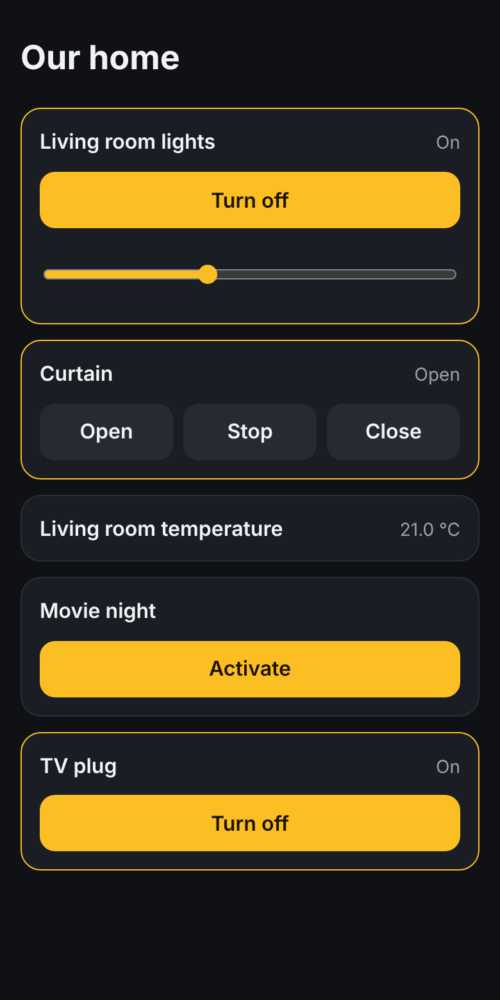
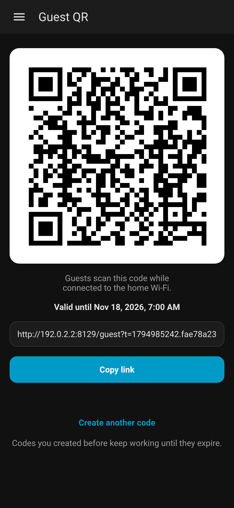
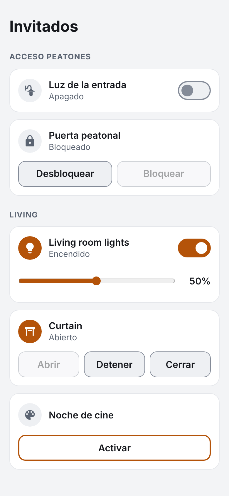
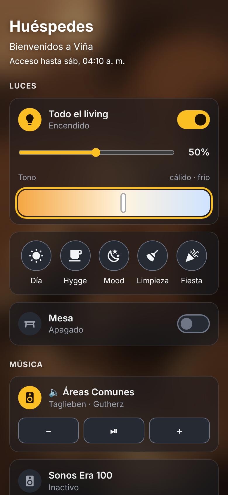
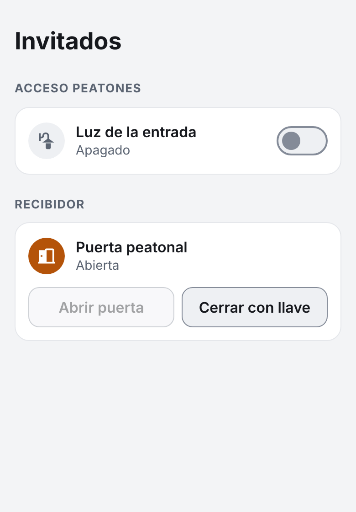
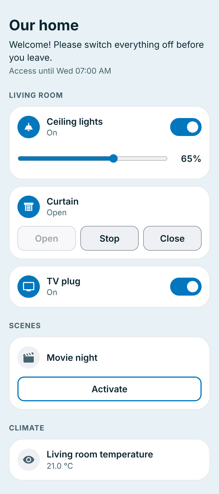
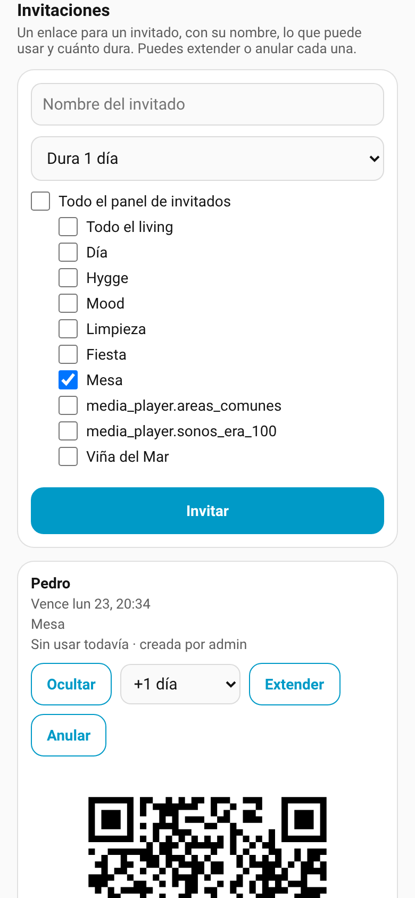

# HA Guest

🇪🇸 [Leer en español](README.es.md)

A Home Assistant integration that lets your guests control **only the entities you choose**, and **only while
they are connected to your network**.

It covers two kinds of guest:

| | Who | How they get in | What they can do |
|---|---|---|---|
| **Guest panel** | A friend visiting your home | Opens `http://<your-home-assistant>:8123/guest` in the browser. No app, no user | Controls the panel's entities, only from your network |
| **Restricted user** | Someone with the Home Assistant app (e.g. a relative who shares their location) | With their own user, in the app or the browser | Always: whatever you allow (e.g. Family Location). Lights and the rest: only while their phone is on your Wi-Fi |

 

## Installation

The repository, to copy and paste:

```
Ctuna89/HA-Guest
```

```
https://github.com/Ctuna89/HA-Guest
```

**Home Assistant 2026.11 or later (Marketplace):**

1. *Settings → Marketplace → Add from link*, paste `Ctuna89/HA-Guest` and select **Add**.
2. Install **HA Guest** and restart Home Assistant.
3. *Settings → Devices & services → Add integration → HA Guest.*

**Earlier versions (HACS):**

1. HACS → ⋮ menu → *Custom repositories* → paste `https://github.com/Ctuna89/HA-Guest`, type **Integration**.
2. Install **HA Guest** and restart Home Assistant.
3. *Settings → Devices & services → Add integration → HA Guest.*

Requires Home Assistant 2025.3 or later.

## Guest panel (no account)

The panel is configured when you add the integration:

- **Allowed networks:** your Wi-Fi network in CIDR format, for example `192.168.1.0/24`. Your Home Assistant's
  own network is suggested. If you have a separate guest network, use that one (and make sure the router lets it
  reach Home Assistant).
- **Entities:** the ones a guest can control. Lights (with brightness and tone), switches, fans (with speed),
  covers, locks (with unlatch where supported), scenes, scripts, buttons, climate, media players (with a volume
  slider) and vacuums get controls; any other entity is shown read-only.

A scene or script runs everything it contains, whatever entities guests see: a «Movie night» script that also
unlocks the front door unlocks it for guests too. Only give guests scripts and scenes you would run for them.

The page updates live: when something changes in the house, guests see it within a second. They can also add the
panel to their phone's home screen (*Share → Add to Home Screen* on iPhone, *⋮ → Add to Home screen* or
*Install* on Android) and open it like an app; it keeps their link.

The page speaks the guest's language: Spanish, English, French, German, Italian, Portuguese or Dutch, from their
phone's settings (English for any other). Entity states use Home Assistant's own words in that language.

Guests open `http://<home-assistant-ip>:8123/guest`. The easiest way is to leave a QR code with that address.
From any other network the page only shows «Connect to the home Wi-Fi» along with the IP address Home Assistant
sees, which helps when adjusting the allowed networks.

### Using a dashboard

Instead of a list of entities, **What guests can control** can be **A dashboard**: build a normal Home Assistant
dashboard for guests (*Settings → Dashboards → Add dashboard*) and pick it. Guests then:

- see every entity the dashboard's cards show, under its view titles, heading cards and card titles, in the same
  order, with the names and icons set on the cards;
- can use only those entities. Remove a card from the dashboard and guests lose that entity at once; add one and
  they get it.

The guest page still draws its own cards: it reads the dashboard, it does not display it, so guests need no
account. Any card that names an `entity` or `entities` is understood (tile, button, entities, glance, light,
thermostat, stacks, grids, conditional cards, picture elements, and custom cards that use those keys). Cards that
pick entities another way, such as an area card, add nothing. The auto-generated «Overview» dashboard cannot be
used until it is edited. With a dashboard as the source, the YAML layout under *Guest panel appearance* is not
used. In Home Assistant only administrators can edit dashboards, so only they can change what guests control.



#### What guests see compared with your dashboard

Guests do **not** see your dashboard as it is: they see the guest page, built from it. Showing the real dashboard
would mean giving each guest a Home Assistant session, which opens much more than their entities (other actions,
history) and would bypass the network check. So:

| From your dashboard | On the guest page |
|---|---|
| Entities, order, view and heading titles, card names and icons | Kept |
| The view's background photo (*Background* setting of the view) | Kept, with frosted-glass cards over it |
| A background set by a theme (`lovelace-background`) | Kept, if you choose that theme under *Guest panel appearance* |
| A background set with card-mod or inside a custom card | Not detected: set it under *Guest panel appearance → Background image* |
| Scenes, scripts and buttons | A row of round buttons |
| Lights | On/off, brightness and, with colour temperature, a tone slider |
| Fans | On/off and, where supported, a speed slider |
| Locks | Lock, unlock and, where supported, unlatch |
| Media players | What is playing, play/pause and a volume slider (no source or zone selection) |
| Weather | Condition and temperature |
| Custom cards' own design (Mushroom, button-card, bubble-card...) | Not reproduced: their entities appear as guest-page cards |
| Greetings, clock, templates, markdown, pop-ups, expandable groups | Not shown |

The yellow of switches is the guest page's default accent colour; set your own under *Guest panel appearance →
Accent colour* to match your dashboard.

### Customising the look

The page follows how your Home Assistant is already set up, and the rest is under **Configure → Guest panel
appearance**:

- **Names and icons** are the ones your entities have in Home Assistant. Change them there and the guest page
  follows.
- **Theme:** any theme installed in your Home Assistant (`frontend: themes:` or HACS themes). Its colours,
  light/dark variants and card corner radius are applied to the guest page.
- **Light or dark mode**, an **accent colour** (`#rrggbb`) that replaces the theme's primary colour, and whether
  to **show icons**.
- **Welcome message:** shown under the title, for example the house rules.
- **Message when a link no longer works:** what a guest sees when their link expired or was revoked, for example
  how to reach you for a new one.
- **Background image:** a photo behind the page, with frosted-glass cards over it, like a dashboard with a
  background. It is taken, in this order, from the *Background image* setting (e.g. `/local/background.jpg`, a file
  in Home Assistant's `www` folder), the chosen dashboard's view background, or the theme's `lovelace-background`.
  With a photo, «light or dark: auto» uses dark mode so text stays readable.

States are shown in Home Assistant's own words and language («Inactivo», «Despejado, de noche · 18 °C»). Scenes,
scripts and buttons next to each other become a row of round buttons, and lights with colour temperature get a
tone slider.


- **Layout (YAML):** by default entities are grouped by area. To choose the order, sections, and per-card names
  and icons, write a layout in the same style as a dashboard's entities card:

  ```yaml
  - title: Living room
    entities:
      - entity: light.living_room
        name: Ceiling lights
        icon: mdi:ceiling-light
      - cover.curtain
  - title: Scenes
    entities:
      - entity: scene.movie_night
        icon: mdi:movie-open
  ```

  Each entity can also say what its state and its buttons read, and use a different icon per state:

  ```yaml
  - title: Entrance
    entities:
      - entity: lock.front_door
        name: Front door
        icon:
          locked: mdi:door-closed-lock
          unlocked: mdi:door-open
        states:
          locked: Locked
          unlocked: Open
        buttons:
          unlock: Open the door
          lock: Lock
  ```

  `buttons` accepts `open`, `close`, `stop`, `lock`, `unlock`, `unlatch`, `activate`, `play_pause`, `start` and `dock`.
  `states` uses the entity's raw states as Home Assistant reports them (`on`, `off`, `locked`, `open`…). Without
  an icon of your own, icons already follow the state the way Home Assistant shows them (an open padlock when
  unlocked, an outline bulb when off).

  

  The layout only arranges cards. Guests can still only use entities on the panel's entity list, and the form
  tells you if the layout names one that is not on it.



Theme values that point at other theme variables (`var(--…)`) are skipped, because they cannot be resolved
outside Home Assistant. The page is not a Lovelace dashboard: it does not run custom cards.

### Expiring links (QR codes)

Being on the Wi-Fi is not always enough: someone you invited once could come back later, stand within reach of
the network and switch your lights off. To prevent that, set **Guest link duration** to a number of hours.

- The plain `/guest` address then stops working. Guests need a link that carries a code, and each link works
  only for that many hours from the moment it was created.
- Links are created on the **Guest QR** page in the Home Assistant sidebar, which shows a fresh QR code every
  time it is opened. The guest scans it with their phone's camera while on your Wi-Fi, or you send them the
  link with **Share link** / **Copy link**.
- **Any Home Assistant user of your household can create codes**, administrator or not, from the app or the
  browser, even when away from home. Restricted users (see below) cannot.
- When a link expires the guest sees «This link is no longer valid» and has to scan a new code.
- **Configure → Revoke all guest links** cuts off every link handed out so far, immediately. Shortening the
  duration also cuts links that were created with a longer one.

With the duration at 0 (the default) links never expire and the Guest QR page simply shows the plain address.
The QR code uses Home Assistant's local address (*Settings → System → Network → Local network*).

Home Assistant cannot see the name of a visitor's Wi-Fi, only their IP address: that is why the panel is
restricted by network. Remote access through Home Assistant Cloud (Nabu Casa) is always rejected. If you use a
reverse proxy, configure `trusted_proxies` under `http:` so Home Assistant sees the visitor's real IP.

### Named invitations

For someone specific, such as a friend staying the weekend or a cleaner every Tuesday, create an invitation on the
**Guest QR** page instead of a quick link:

- **Guest's name**, **how long** it lasts (2 hours to 30 days) and **what they can use**: the whole guest panel,
  or only some of its entities.
- Share it as a QR code or a link. Everything they do is logged under their name («Pedro (192.168.1.20) turned off
  Living room lights»).
- **Starts** (optional): it only works from then on, for example check-in. Before that the guest sees when it
  starts. The duration counts from the start.
- **Only while** a schedule or input boolean helper is on, for example a «Cleaning» schedule on Tuesdays from 9 to
  13. Outside it the guest sees that they have no access right now.
- **Only one phone:** the first phone that opens the link keeps it, and the same link forwarded to anyone else
  says it was already opened on another phone. **Free the phone** lets them open it on a new one. This stops casual
  forwarding, not a guest determined to share their own phone's link.
- The list shows when each invitation starts and expires, when it was last used and who created it. **Extend**
  adds time without changing the link they already have (also for one that just expired), and **Revoke** ends it
  at once, even on a page that is open.

Anyone in the household can create, extend and revoke invitations, but only with entities already on the guest
panel. Restricted users cannot. Invitations are not tied to the link duration in the panel settings; expired ones
stay listed for a week so you can extend them.



### Invitations from automations

Three actions let automations manage invitations, for example for holiday rentals:

- **`ha_guest.create_invitation`**: `name`, and optionally `entities`, `starts`, `duration` or `ends`,
  `condition_entity` and `single_device`. It returns the invitation's `url`, its id and its dates.
- **`ha_guest.extend_invitation`**: `invitation` (its id or name) and `duration`.
- **`ha_guest.revoke_invitation`**: `invitation` (its id or name).

```yaml
# When a booking arrives: an invitation from check-in to check-out, sent to your phone.
actions:
  - action: ha_guest.create_invitation
    data:
      name: "Booking {{ trigger.event.data.code }}"
      starts: "{{ trigger.event.data.check_in }}"
      ends: "{{ trigger.event.data.check_out }}"
      single_device: true
    response_variable: invitation
  - action: notify.mobile_app_my_phone
    data:
      message: "Guest link for {{ invitation.name }}: {{ invitation.url }}"
```

Dates without a time zone are in Home Assistant's. Entities must be on the guest panel.

### Permanent QR codes (a code on the nightstand)

For a room guests use again and again, such as a guest bedroom, print a code once instead of creating one per
visit: **Configure → Permanent QR codes → Add**.

- **Name**, for example «Guest bedroom». It is printed under the code and shown in the logbook («Guest bedroom
  (192.168.1.20) turned off Bedside lamp»).
- **Entities it allows:** only these, for example that room's lights. Empty means the whole guest panel.
- **Session length** in days. Each phone that scans the code can use it for that long, then has to scan it again.

Print it from the **Guest QR** page in the sidebar: each permanent code has a **Print** button that opens a sheet
with the code, its name and a one-line instruction.

#### NFC tags

A permanent code can also go on an NFC tag (a sticker or a small disc, NTAG213 or larger), so guests just hold their
phone to it. iPhones (XS and later) and most Android phones open the link without any app, and from there it works
exactly like scanning the QR code.

- **Write NFC tag** on the **Guest QR** page writes it directly. Browsers only allow this in Chrome on Android with
  Home Assistant opened over https (for example your Home Assistant Cloud address); the tag still gets the local
  address guests use at home.
- Anywhere else, **Copy link** and write it as a *URL* record with an app such as NFC Tools.
- **Lock the tag afterwards** makes it read-only so nobody can overwrite it with another link. It cannot be undone:
  if you later replace the code, use a new tag.

**What this trades away:** the printed code itself never expires. Anyone who can see it (or a photo of it), or
who taps the NFC tag, and is on your network can start a new session. The session length only limits how long a phone keeps access without
the code in front of it. Keep the allowed entities to that room, and combine it with a guest Wi-Fi or «Only while
someone from the household is home». To revoke it, use **Edit → Replace this QR code** (the old printout and every
session started with it stop working) or remove the code. Guest network, address and pause rules apply as usual.

### Safety and notifications

Under **Configure → Safety and notifications**:

- **Only while someone from the household is home:** the panel stops answering when no `person` is `home`.
  People who are restricted users (a relative sharing their location) do not count. This is what stops someone
  you invited once from standing outside, within reach of the Wi-Fi, while nobody is in.
- **Only while this entity is in one of these states:** for example your alarm, `disarmed`.
- **Notify** one or more notify services (e.g. `mobile_app_my_phone`) **when** a guest opens the panel, uses
  something, or someone is turned away (an expired or invalid link, or the panel is paused). Repeated attempts
  from the same guest are reported at most once an hour.

While paused, guests see «The guest panel is not available right now», whatever the reason, so the page never
reveals that nobody is home.

Everything guests do is recorded in the **logbook** («Guest (192.168.1.20) turned off Living room lights»),
including on the entity's own history, and fired as an `ha_guest_event` event for automations:

| `type` | Extra data |
|---|---|
| `open` | |
| `action` | `entity_id`, `name`, `action` (`turn_on`, `turn_off`, `open`, `brightness`…), `value` |
| `blocked` | `reason`: `link` or `paused` |

Every event also has `ip`, `link` (a short id of the guest's link, when links are required) and `link_expires`.

The integration adds three entities on a «Guest panel» device:

- **`switch.guest_panel`**: pauses the panel without touching its settings. Use it from a dashboard or an
  automation (e.g. off when the alarm is armed); it keeps its state across restarts.
- **`binary_sensor.guest_panel_in_use`**: on while a guest has the panel open or used it in the last 5 minutes,
  with the number of `guests` and `last_seen` as attributes.
- **`image.guest_panel_qr_code`**: a QR code with a quick link to the whole guest panel, for a dashboard on a wall
  tablet by the door. It renews itself at half the link duration, so whoever scans it always gets at least half;
  with a duration of 0 it is the plain panel address. Anyone who can see the tablet can scan it, so put it where
  only people inside the house can.

The entity ids above are for an English Home Assistant; they follow its language when the integration is added.

### Security

What the guest panel checks on every request, and what that means:

- **Network:** only addresses in the allowed networks get in. Home Assistant Cloud is always refused, and forged
  `X-Forwarded-For` or `Forwarded` headers are ignored unless they come from a proxy you listed in `trusted_proxies`.
  Never add your reverse proxy's or Docker's internal network to the allowed networks.
- **Link:** with a link duration above 0 (12 hours by default), a link only works until it expires. An old QR code,
  a link with its date changed, or a made-up one is refused; the signature is 128 bits. **With 0, no link is needed
  at all: anyone on the allowed networks gets in, even with an old QR code.**
- **Address:** the panel only answers when opened through an IP address, a `.local` name, or Home Assistant's
  internal or external URL, so a website opened on the home network cannot use it through its own domain name
  (DNS rebinding). If you open it through another name, set that name as the internal URL.
- **Actions:** only entities on the panel's list (or dashboard), and only the actions their card offers. At most
  30 actions a minute per guest, and 10 attempts a minute per address at redeeming a permanent code.
- **Page:** a strict Content Security Policy (only the page's own script and styles, with a new nonce on every
  load), and every response is sent with `nosniff`, `no-referrer`, `no-store` and framing denied. Links carry
  tokens, so they are never sent to other sites as a referrer.

What it cannot prevent: a link that is still valid works for anyone it is forwarded to who is on your network,
until it expires or you revoke it (named invitations can be revoked one by one). Keep the duration short, revoke all links when needed, and consider «Only while someone from the
household is home». A permanent QR code never expires at all; see what that means under «Permanent QR codes».

For restricted users, a Wi-Fi name (SSID) is easy to imitate: anyone can name a hotspot like your network. Prefer
the phone's BSSID sensor (your router's address) or, better, a `device_tracker` from your router.

## Restricted users (with the app)

1. Create the person in *Settings → People* with a user that is **not an administrator**, and install the app
   for them.
2. On the integration page: **Configure → Restrict a user**.
3. Set their permissions:
   - **Entities always allowed:** they can see and control these from anywhere.
   - **Include Family Location:** always allows the map (people and zones) and the
     [Family Location](https://github.com/Ctuna89/HA-Family-Location) entities, including the check-in and
     ask-for-help buttons.
   - **Entities allowed only at home:** e.g. the living room lights.
   - **Entity that shows they are home**: usually their phone's Wi-Fi connection sensor
     (`sensor.<phone>_wifi_connection` on Android, `sensor.<phone>_ssid` on iPhone) and the name of your Wi-Fi.
     You can also use a `device_tracker` from your router with the state `home`, which is harder to fool than a
     network name.
   - **When away, show them read-only:** if off, these entities do not appear to them while away.
4. The next step shows **what that entity reports right now** and offers it as the «home» state. If the phone is
   on your Wi-Fi at that moment, accept it; a state that does not match exactly never grants access.

Anything not on those lists they can no longer see or control. Home Assistant enforces the restriction on the
server, so it applies equally to the app, the browser and the API.

### Good to know

- On arriving home, the «home only» entities can take a while to show up in an app that was already open: they
  appear when their state changes or when the app is reopened.
- Their default dashboard is the same as yours, with gaps where they have no permission. It is worth creating a
  dashboard of their own with what they can use and making it their default.
- The restriction covers seeing state and controlling entities. Home Assistant does not filter everything else
  per user: a restricted user can still run actions that do not target an entity (such as Family Location's
  check-in and help actions, which is the intent), and parts like history do not always honour permissions.
- Custom permission groups have no public API in Home Assistant; the integration uses its internal user storage,
  so a future Home Assistant release may require an update.
- If you disable the integration, restricted users keep their «away» access. When you stop restricting a user,
  or delete the integration, they get normal access back.

## Acknowledgements

Thanks to [@rohithkadaveru](https://github.com/rohithkadaveru) for
[HAPass](https://github.com/rohithkadaveru/ha-pass), a Home Assistant add-on for shareable guest links. Several
ideas in HA Guest 0.9.0 come from it: named invitations that can be extended or revoked one by one, live updates,
installing the guest panel on the home screen, rate limiting, strict security headers, a custom message for
expired links, and fan speed, lock unlatch and volume controls. If you prefer an add-on with links that also work
outside your home network, give it a look.

Thanks also to [@Darkdragon14](https://github.com/Darkdragon14) for
[Guest Mode](https://github.com/Darkdragon14/ha-guest-mode), which logs guests into Home Assistant itself with a
temporary link. HA Guest 0.9.1 takes from it the actions for automations, invitations that start later or only
work while a schedule or helper is on, the QR code image entity, and more languages.

## Development

```bash
pip install pytest-homeassistant-custom-component segno==1.6.6
```

```bash
python -c "import json, pathlib, homeassistant.components.frontend as f; print(*json.loads((pathlib.Path(f.__file__).parent / 'manifest.json').read_text())['requirements'])" | xargs pip install
```

```bash
pytest tests
```

### Releasing

Releases are published by `.github/workflows/release.yml` when `main` changes: raise `version` in
`custom_components/ha_guest/manifest.json`, add its section to `CHANGELOG.md`, and merge into `main`. The workflow
creates the `v<version>` release with that section as notes, and does nothing if the version was already released.
